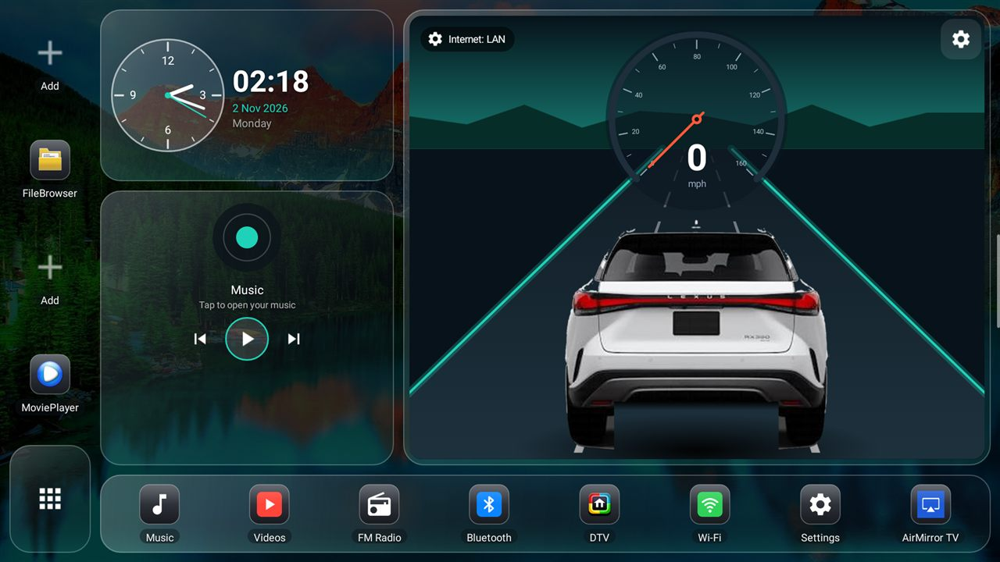
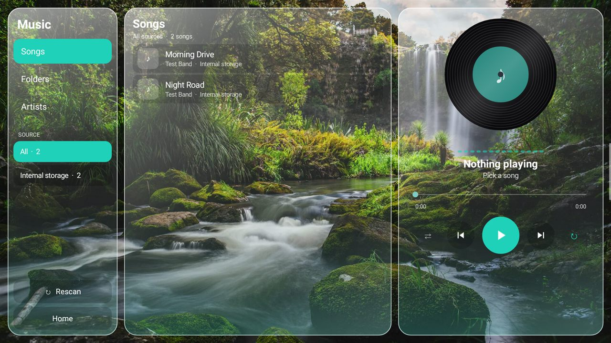
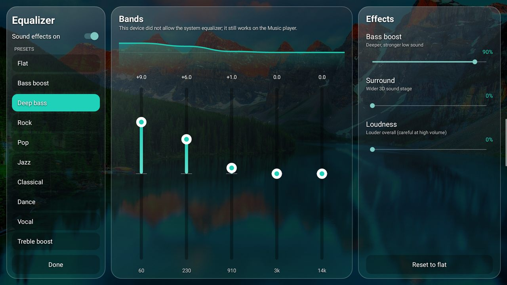
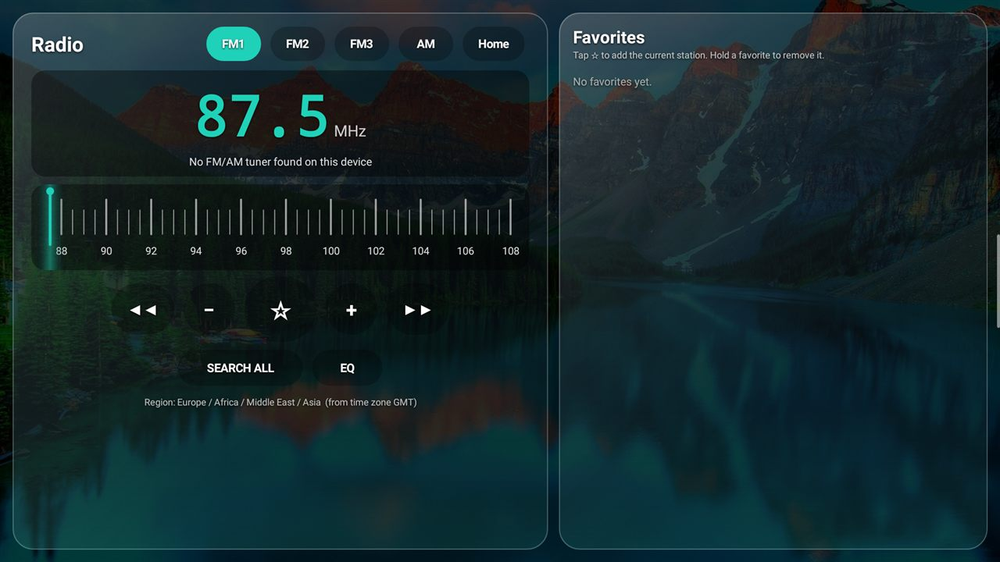
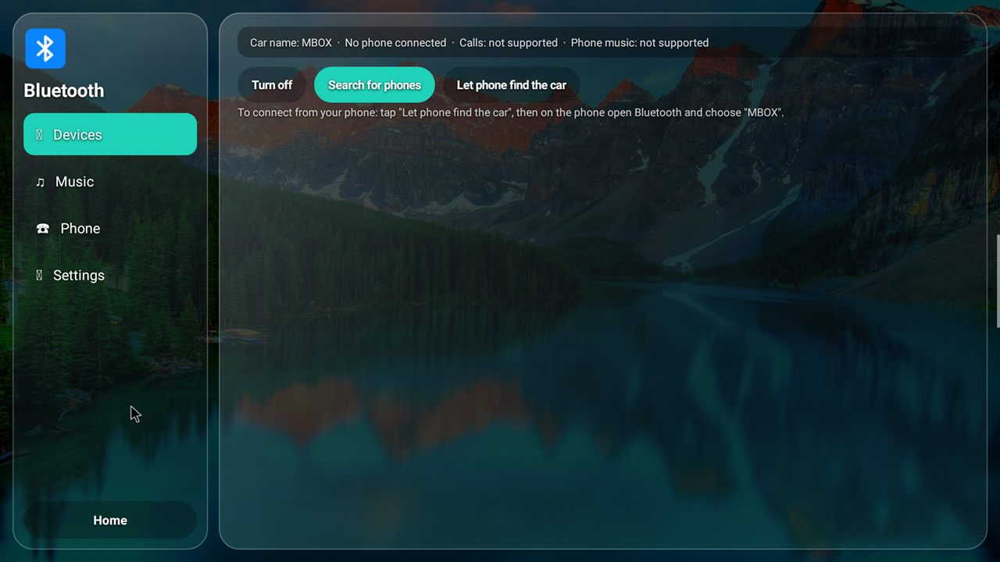
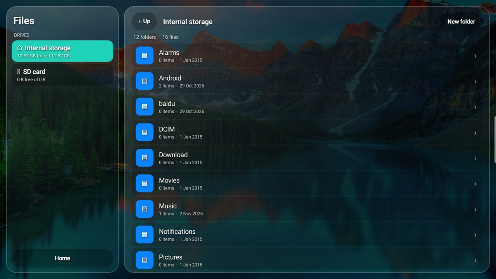
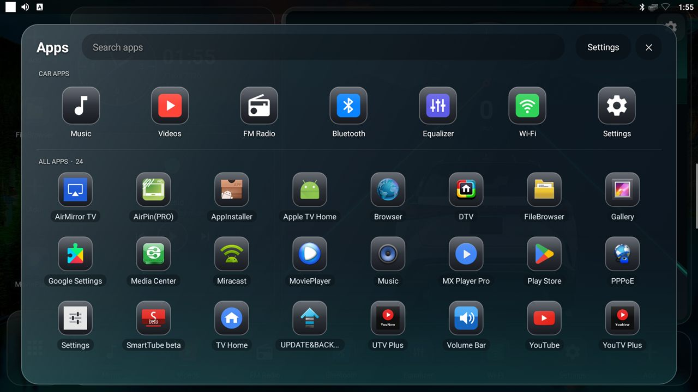
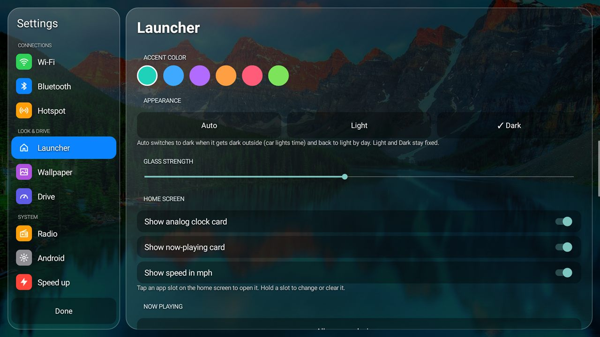
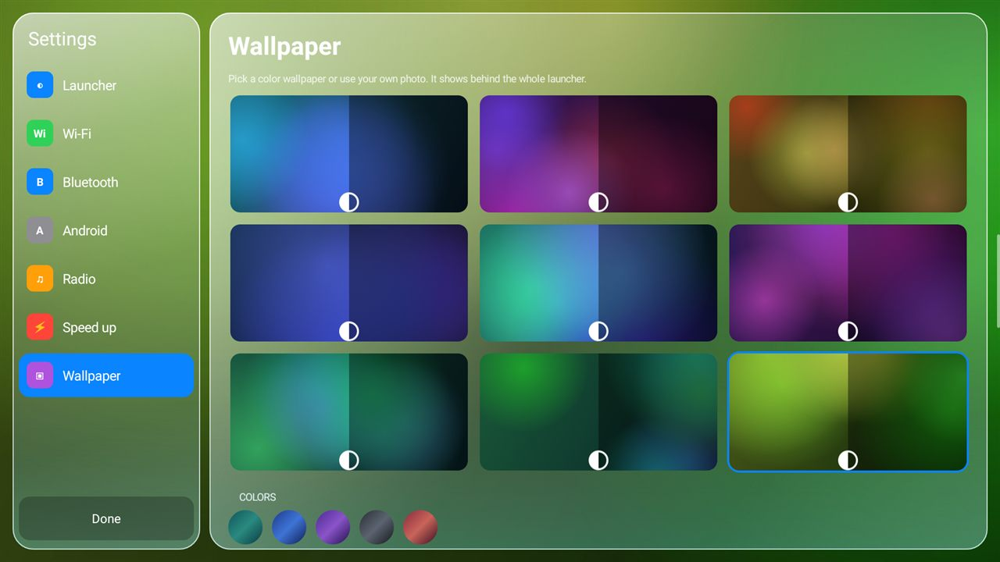

<div align="center">

# 🚗 Car Launcher

### A fast, liquid-glass home screen for Android car radios and Android boxes

One small APK gives you the launcher plus Music, Videos, Radio, Bluetooth, Files and Equalizer apps.


 



</div>

---

## ✨ Highlights

| | |
|---|---|
| ⚡ **Fast on weak hardware** | Built with the plain Android SDK, no libraries. Animations run only while visible or moving. Memory clean-up is built in. |
| 🪟 **Liquid glass design** | Frosted glass cards over your wallpaper, with light, dark, or automatic night mode. |
| 🧭 **Live speedometer** | GPS speed in km/h or mph over a moving road, with your car (drawn or a real photo) and rolling tyres. |
| 🧩 **Fully customizable** | Dock (6, 8 or 10 apps), sidebar, sides, speedometer style, size and position, car model, colour and size, accent and wallpaper. |
| 📶 **Connection status** | Internet, Wi-Fi, Bluetooth, hotspot and USB shown on the home screen, with a pop-up when something connects. |
| 📦 **All in one APK** | Install once and get every app below. |

---

## 📱 Built-in apps

<table>
<tr>
<td width="50%"><br><b>🎵 Music</b>: songs, folders and artists from internal storage, SD card and each USB drive. Spinning disc, equalizer bars, shuffle, repeat and background play.</td>
<td width="50%"><br><b>🎚 Equalizer</b>: 11 presets, band sliders, bass boost, <i>bass only</i>, surround and loudness.</td>
</tr>
<tr>
<td><br><b>📻 Radio</b>: FM1, FM2, FM3 and AM tuner, band plan taken from your time zone, seek, fine tune, search all and favorites.</td>
<td><br><b>🔵 Bluetooth</b>: pair your phone, play its music, a dial pad for calls, and rename the car.</td>
</tr>
<tr>
<td><br><b>📁 Files</b>: every drive as a tab. Select several files to rename, copy, move, delete, zip or extract them, or drag and drop. Install APKs.</td>
<td><br><b>🔎 App library</b>: swipe up from the bottom. Search, a car-apps row, and every app A–Z.</td>
</tr>
<tr>
<td><br><b>⚙️ Settings</b>: Wi-Fi, Bluetooth and Hotspot with on/off switches, every Android settings page, wallpapers, Drive and Speed up.</td>
<td><br><b>🖼 Wallpapers</b>: bundled photos, colours, your own photo, or a random Full HD wallpaper by day or at each start.</td>
</tr>
</table>

**🎬 Videos**: thumbnail library by drive and folder, and a full-screen player with ±10 s, next and previous.

---

## 🚀 Install

1. Copy **[`release/CarLauncher.apk`](release/CarLauncher.apk)** to the unit and open it, or from a PC run:
   ```bash
   adb install -r release/CarLauncher.apk
   ```
2. Press **Home** and choose **Car Launcher → Always**, or use *Settings → Speed up → Make Car Launcher the default*.
3. *(Optional)* To let *Speed up* turn system animations off, run this once from a PC:
   ```bash
   adb shell pm grant com.carlauncher android.permission.WRITE_SECURE_SETTINGS
   ```

## 🛠 Build from source

```bash
gradle assembleRelease
# output: app/build/outputs/apk/release/app-release.apk
```

Requires JDK 17 and the Android SDK (compileSdk 34). The SDK path is set in `local.properties`. See [TECHNICAL.md](docs/TECHNICAL.md) for the architecture, and [PRODUCTION.md](docs/PRODUCTION.md) for release steps.

---

## ⚠️ Good to know

| Feature | Needs |
|---|---|
| **Radio** | A real FM/AM tuner. Each head-unit maker uses its own driver, so units without a supported tuner show *"No FM/AM tuner found"*. |
| **Phone calls and phone music** | A head unit whose Bluetooth runs in car mode (hands-free and A2DP sink). The app shows whether your unit supports them. |
| **Equalizer for other apps** | Device support. It always works on the built-in Music player. |
| **Disable other launchers** | Car Launcher keeps them stopped and hidden. Nothing is uninstalled. |
| **Media formats** | Whatever your device's Android can decode: MP3, AAC, FLAC, OGG, Opus, WAV, MP4, MKV, WebM and more. |

---

## 📚 Documentation

| File | What's inside |
|---|---|
| [TECHNICAL.md](docs/TECHNICAL.md) | Architecture, components, rendering, media and radio internals |
| [PRODUCTION.md](docs/PRODUCTION.md) | Release checklist, signing and device notes |
| [SECURITY.md](SECURITY.md) | Permissions, data handling and how to report a problem |
| [LICENSE.md](LICENSE.md) | MIT for code, and the terms for bundled images |
| [CLAUDE.md](CLAUDE.md) | Guide for contributors and AI assistants |

<div align="center">

Made for the road 🛣️

© 2026 MB

</div>
